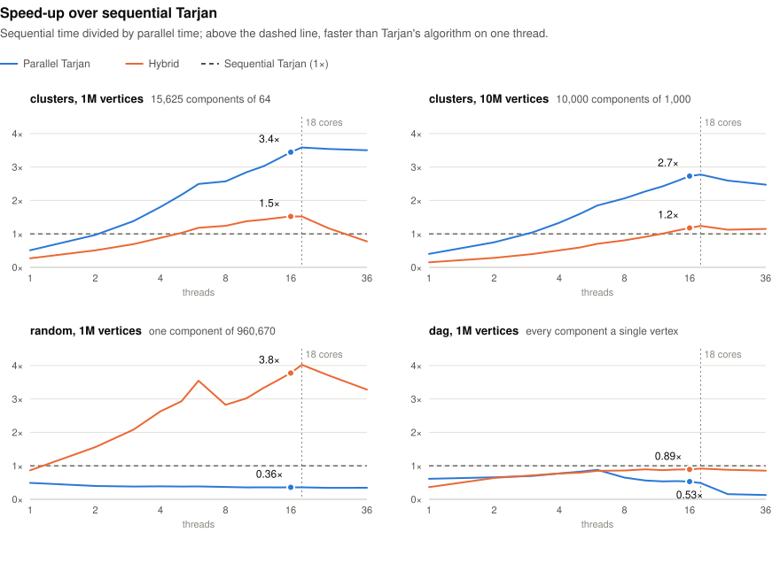
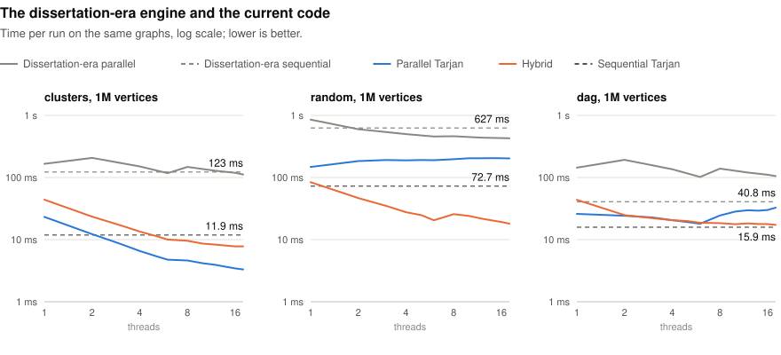

# ParallelTarjan

A parallel version of Tarjan's algorithm for strongly connected components
(SCCs), from Alex Zabrodskiy's Oxford MSc dissertation (2017, supervised by
Gavin Lowe). Several depth-first searches run at once. A search that reaches a
vertex owned by another search suspends until that vertex is assigned to a
component, and searches that end up blocking each other in a cycle are merged by
moving vertices between their stacks. See [the dissertation](dissertation.pdf)
for the algorithm, its correctness argument, and the original measurements.

Because of how it splits the work, the parallel search cannot speed up a graph
with one giant component: every search that enters it is merged into one. For
such graphs the library also has a [hybrid algorithm](#the-hybrid-algorithm)
that removes the giant component first, using breadth-first parallel phases, and
then runs the parallel search on what is left. A sequential, iterative Tarjan's
algorithm is the baseline for the benchmarks and the reference in the tests.

## Build and run

Requirements: a C++20 compiler, CMake 3.20+, and a thread library. The code has
been tested with Apple clang 21; CI builds it with GCC on Ubuntu and with Apple
clang on macOS. CMake downloads one header-only dependency,
[moodycamel::ConcurrentQueue](https://github.com/cameron314/concurrentqueue)
v1.0.4, pinned by SHA-256. To build offline, set
`FETCHCONTENT_SOURCE_DIR_CONCURRENTQUEUE` to a local copy of that release.

```sh
cmake -S . -B build -DCMAKE_BUILD_TYPE=Release
cmake --build build --parallel
ctest --test-dir build --output-on-failure
./build/ptarjan_demo 8
```

The demo finds the three components of a small graph:

```text
Strongly connected components (8 workers):
{0, 1, 2}
{3, 4}
{5}
```

## Library use

Vertices are numbered `0 .. n-1`. A `Graph` is immutable and stored in
compressed sparse row form; build it from an edge list or from adjacency lists.

```cpp
#include "ptarjan/scc.hpp"

const std::vector<ptarjan::Edge> edges{{0, 1}, {1, 0}, {1, 2}};
const ptarjan::Graph graph(3, edges);

ptarjan::Components components = ptarjan::parallelScc(graph, 8);
// or hybridScc(graph, 8) for a graph with a giant component, or sequentialScc(graph)
for (std::span<const ptarjan::Vertex> component : components) {
    // ...
}
```

- `parallelScc(graph, threads)` and `hybridScc(graph, threads)` accept any
  positive number of threads and default to the hardware concurrency. Which is
  faster depends on the graph; see Benchmarks.
- `Components` owns its result: every component is a span into one shared
  buffer, so a result costs two allocations however many components there are.
- The order of components, and of vertices within a component, is
  unspecified. `normalized()` sorts both, so two results can be compared with
  `==`; `toVectors()` copies the result into nested vectors.
- If a worker throws (in practice `std::bad_alloc`), the other workers stop and
  the call rethrows the exception.
- To use graphs whose vertex identifiers are not dense, number them
  `0 .. n-1` first; `bench/graph_sources.cpp` shows one way.

Link against the `ptarjan::ptarjan` target, for example after
`FetchContent_MakeAvailable` or `add_subdirectory`.

## Benchmarks

`ptarjan_bench` times the algorithms on a seeded synthetic graph or a graph
file, and checks every parallel result against the sequential one:

```sh
./build/ptarjan_bench --graph clusters --vertices 1000000 --threads 1,2,4,8,16 --runs 7
./build/ptarjan_bench --graph edges:soc-LiveJournal1.txt --threads 8   # SNAP edge list
./build/ptarjan_bench --algorithms hybrid --graph random --threads 16
./build/ptarjan_bench --help
```

The `csp:FILE` format reads the state-space graphs used in the dissertation.

### Results

Median times at 16 threads on an 18-core Apple M5 Max (6 Super and 12
Performance cores). The 1M-vertex graphs have about four edges per vertex, the
10M-vertex graph six:

| Graph | Sequential | Parallel Tarjan | Hybrid |
| --- | --- | --- | --- |
| `clusters`, 1M vertices: 15,625 components of 64 | 11.9 ms | **3.4 ms (3.4×)** | 7.8 ms (1.5×) |
| `clusters`, 10M vertices: 10,000 components of 1,000 | 133 ms | **48.6 ms (2.7×)** | 113 ms (1.2×) |
| `random`, 1M vertices: one component of 960,670 | 72.7 ms | 204 ms (0.36×) | **19.2 ms (3.8×)** |
| `dag`, 1M vertices: every component a single vertex | **15.9 ms** | 30.0 ms (0.53×) | 17.8 ms (0.89×) |

<picture>
  <source media="(prefers-color-scheme: dark)" srcset="docs/benchmarks/speedup-dark.svg">
  
</picture>

Each time is the median of 5 to 7 runs, and the fastest of three passes taken
minutes apart while other processes used less than one core. The raw results
and the script that draws the charts are in [docs/benchmarks](docs/benchmarks).

Parallel Tarjan does well when the graph splits into many components: at 16
threads it is 3.4 times as fast as the sequential algorithm on the 1M-vertex
clustered graph and 2.7 times as fast on the 10M-vertex one. Three things hold
the speed-up down. On one thread it costs about twice as much as
the sequential algorithm, because each vertex carries 32 bytes of state instead
of 8 and the search keeps bookkeeping for suspending and merging. Beyond six
threads, the work spills onto the slower Performance cores. And a cluster can be
finished only after every cluster it reaches, so with many workers there is
often nothing ready to run.

A giant component defeats it. On the random graph, where 96% of the vertices
form one component, parallel Tarjan gets slower as threads are added: every
search that enters the giant component is merged into one, and a single worker
ends up doing most of the work. The hybrid algorithm was added for this case. At
16 threads it is 3.8 times as fast as the sequential algorithm and 10.6 times as
fast as parallel Tarjan.

Neither algorithm beats the sequential one on the DAG. Each component there is a
single vertex, but a vertex can be finished only after its successors, so
parallel searches spend their time waiting for each other, and trimming peels
the graph only a thin layer at a time. The best result is 0.92 times, from the
hybrid algorithm at 18 threads.

Past 18 threads there are more threads than cores, and a descheduled worker
holds up every search waiting on its vertices. On the DAG, parallel Tarjan takes
three and a half to four times as long at 24 and 36 threads as at 16. Use no
more threads than free cores; the default is the hardware thread count.

Choose the algorithm by the shape of the graph:

| Graph | Use |
| --- | --- |
| Many medium-sized components, as in clustered graphs | `parallelScc` |
| One giant component, typical of web, social and citation graphs | `hybridScc` |
| Long chains of dependencies, as in a deep DAG | `sequentialScc` |

`hybridScc` needs more memory. On the 10M-vertex graph, which itself takes
0.33 GB, its peak was 1.9 GB against 1.3 GB for `parallelScc`.
[Sections 11 and 12 of the audit](docs/concurrency-audit.md) break down the
costs and show where the workers' time goes.

## The hybrid algorithm

Parallel Tarjan gets its speed from running many depth-first searches at once in
different parts of the graph. When most of the graph is one component, the
searches all end up inside it and have to be merged, and the work becomes
sequential again. `hybridScc` removes the giant component by other means first:

1. **Trim.** A vertex with no incoming edges, or no outgoing ones, cannot be on
   a cycle, so it is a component by itself. Removing it can leave its neighbors
   in the same position, so trimming repeats until no such vertex is left. On a
   DAG this removes every vertex.
2. **Forward-backward search.** The vertices that a pivot can reach, and that
   can reach the pivot, are exactly the pivot's component. Each set takes one
   breadth-first search, along the edges and against them, and breadth-first
   search parallelizes well: the threads split each level's frontier between
   them. The pivot is the vertex with the largest in-degree times out-degree,
   which on a graph with a giant component usually lies inside it.
3. **Parallel Tarjan on the rest.** The removed vertices are marked as
   finished, and the parallel search handles what remains, typically many small
   components.

The first two steps remove only whole components, so no remaining component
passes through a removed vertex and the parallel search runs unchanged. The
design follows the Multistep method of Slota, Rajamanickam and Madduri ("BFS and
Coloring-based Parallel Algorithms for Strongly Connected Components and Related
Problems", IPDPS 2014), which ends with a coloring phase and a sequential search
instead. [Section 12 of the audit](docs/concurrency-audit.md#12-a-hybrid-algorithm-for-graphs-with-a-giant-component)
covers the implementation, its costs and its testing.

## Is it lock-free?

The coordination uses no locks. Claiming a vertex, suspending a search,
recording it in a vertex's blocked list, detecting and resolving a blocking
cycle, and the termination count all use atomic operations that finish in a
bounded number of steps. The pending-search queue is lock-free apart from
memory allocation.

`hybridScc` is not lock-free by design: its breadth-first phases wait for
each other at barriers.

The parallel search as a whole is not lock-free either, as the dissertation notes
(section 1.2). Only the thread running a search can advance its depth-first
search. While there are more searches than threads, a stalled thread holds up
only the searches waiting on its vertices. Near the end of a run, the remaining
threads can only wait for it, and they poll with a 1 ms sleep. Memory
allocation can also take locks.

## How this version differs from the dissertation's code

The dissertation's implementation is tagged
[`dissertation-2017`](https://github.com/azabrod1/ParallelTarjan/tree/dissertation-2017).
Since then:

- **Dense vertex identifiers.** The original mapped arbitrary vertex
  identifiers to cells through a concurrent hash table (with seven
  interchangeable backends), and recycled cells with generation counts and
  reference counting to halve its memory use. With vertices numbered
  `0 .. n-1`, each vertex has a 32-byte cell for the whole run. The hash tables, recycling, and
  reference counting are gone, along with two contended atomic operations per
  edge.
- **Termination.** One bit per worker in a 64-bit word was replaced by a count
  of active searches. The old protocol limited runs to 64 threads and could
  hang when one idle thread was descheduled; see the audit, section 8.
- **Correctness fixes.** Generation checks, publication order, a cycle walk
  that could loop, and several data races; see the audit.
- **A hybrid algorithm** for graphs with a giant component (`hybridScc`); see
  [above](#the-hybrid-algorithm).
- **Root blocks.** Workers take blocks of up to 256 root vertices instead of
  one vertex at a time. This spreads the searches across the graph and removes
  a shared counter that every worker incremented for every vertex.
- **Modern C++.** C++20, value-owned results, RAII throughout, `std::jthread`,
  and a seeded benchmark tool in place of the original driver.

On the same graphs and machine, the current code is much faster than the
dissertation-era engine. At 16 threads parallel Tarjan is 35 times as fast as
the old engine on the clustered graph and 3.7 times as fast on the DAG, and on
the random graph the hybrid algorithm is 22 times as fast:

<picture>
  <source media="(prefers-color-scheme: dark)" srcset="docs/benchmarks/dissertation-dark.svg">
  
</picture>

The dissertation-era engine here is the 2017 code with the audit's bug fixes
applied, reading the same graphs with the same vertex numbering. Its sequential
algorithm also used a hash table, and was 2.6 to 10 times slower than today's,
so the dissertation's speed-ups were measured against a much slower baseline.
[docs/concurrency-audit.md](docs/concurrency-audit.md) records each defect
found in the original code, with evidence and measurements.

## Testing

The tests compare every vertex's component with an independent Kosaraju
implementation. They cover empty graphs, self-loops, duplicate edges, long
chains and cycles, seeded random graphs, 1 to 128 threads started
simultaneously, synchronized contention, many searches suspended on one vertex,
and long runs at 63 to 128 threads on small graphs, where termination problems
show up. Every differential test also checks the hybrid algorithm, and its own
test covers DAGs, giant components with trees on both sides, and equal-sized
components at 1 to 64 threads. CTest applies timeouts so a hang is reported as a
failure.

```sh
# Invalid memory access and undefined behavior
cmake -S . -B build-asan -DCMAKE_BUILD_TYPE=Debug -DPTARJAN_SANITIZER=address
cmake --build build-asan --parallel
ASAN_OPTIONS=detect_leaks=1:halt_on_error=1 UBSAN_OPTIONS=halt_on_error=1 \
  ctest --test-dir build-asan --output-on-failure

# Data races
cmake -S . -B build-tsan -DCMAKE_BUILD_TYPE=Debug -DPTARJAN_SANITIZER=thread
cmake --build build-tsan --parallel
TSAN_OPTIONS=halt_on_error=1 ctest --test-dir build-tsan --output-on-failure -L tsan-core
```

GCC's ThreadSanitizer does not model the atomic fences in the lock-free queue
([upstream discussion](https://github.com/cameron314/concurrentqueue/issues/146)),
so CI runs only the `tsan-core` tests, which use a mutex-backed queue. With
Clang's ThreadSanitizer on macOS the whole suite passes without reports. (On
macOS, LeakSanitizer is unavailable, so drop `detect_leaks=1`.)

### Model checking

`spec/` holds TLA+ models of the scheduler's protocols, checked with TLC
(`spec/run.sh` downloads TLC, verifies its checksum, and reruns every
configuration). Within small bounds (2 to 3 workers, 2 to 4 vertices or
searches), TLC found no counterexample for:

- **termination**, with root blocks: no worker exits while a search is
  running, waiting to run, or held in an unexamined block. Every worker
  exits once every search is done, even if idle workers stall forever;
- **suspension**: a suspended search is resumed exactly once, never lost, even
  with stale blocked-list entries, lazily allocated lists, and transfers;
- **cycle detection**: two threads never resolve overlapping blocking cycles,
  and no blocking cycle is left unresolved.

The original termination protocol fails in the model in three ways,
including the early exit and the stalled-worker hang the audit describes; the
counterexample traces are in `spec/results/`. Deliberately broken variants of
each protocol are caught, so the passes are not vacuous.
[spec/README.md](spec/README.md) maps each model action to the code and lists
what the models leave out.

## Development

The sources are formatted with clang-format 23 (`.clang-format`) and checked
with clang-tidy (`.clang-tidy`):

```sh
clang-format -i include/ptarjan/*.hpp src/*.hpp src/*.cpp src/parallel/* bench/* examples/*.cpp tests/*.cpp
clang-tidy -p build src/*.cpp src/parallel/*.cpp bench/*.cpp examples/*.cpp
```

Both are available from PyPI (`pip install clang-format clang-tidy`). CI checks
formatting. `-DPTARJAN_WARNINGS_AS_ERRORS=ON` turns the project's compiler
warnings into errors. `python3 docs/benchmarks/plot.py` redraws the benchmark
charts from `docs/benchmarks/results.csv`, which uses the column layout of
`ptarjan_bench --csv`.

| Path | Contents |
| --- | --- |
| `include/ptarjan/` | Public API: `Graph`, `Components`, `sequentialScc`, `parallelScc`, `hybridScc` |
| `src/` | The sequential and hybrid algorithms, graph and result types |
| `src/parallel/` | The parallel algorithm: cells, searches, workers, suspension, termination |
| `bench/` | `ptarjan_bench` and its graph generators and file readers |
| `tests/` | CTest suites |
| `spec/` | TLA+ models of the scheduler protocols |
| `docs/` | The concurrency audit |
| `docs/benchmarks/` | Benchmark results and the script that draws the charts from them |

Contact: alex.zabrodskiy86@gmail.com.
